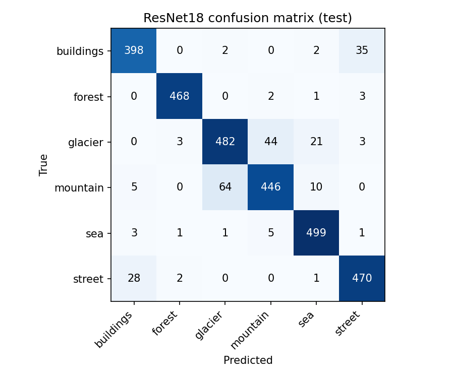
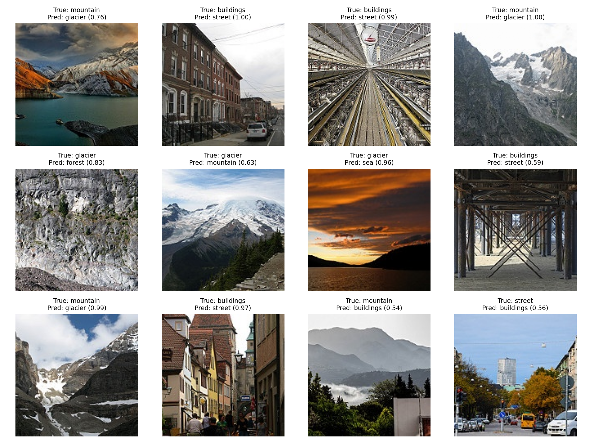
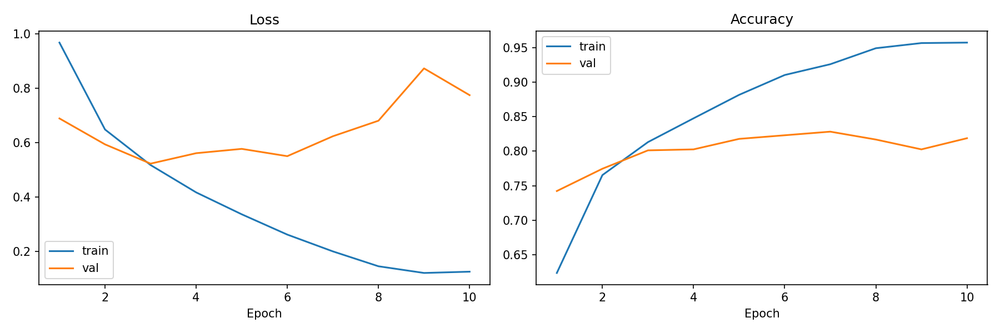

# Intel Scene Classification: CNN from Scratch vs Transfer Learning

Image classification on the [Intel Image Classification](https://www.kaggle.com/datasets/puneet6060/intel-image-classification) dataset (6 scene classes: buildings, forest, glacier, mountain, sea, street). The project compares a CNN built from scratch against a fine-tuned, ImageNet-pretrained ResNet18, and tests whether data augmentation reduces overfitting.

## Results

All numbers are on the held-out test set (3,000 images), using the checkpoint with the best **validation** accuracy.

| Model | Test accuracy | Test loss | Train-val accuracy gap (final epoch) |
|---|---|---|---|
| CNN from scratch (3 conv blocks) | 83.8% | 0.573 | 0.138 |
| ResNet18, fine-tuned | **92.1%** | 0.274 | 0.068 |
| ResNet18, fine-tuned + augmentation | 92.0% | **0.232** | **0.013** |

Key findings:

- **Transfer learning gave the biggest gain:** +8.3 points of accuracy and roughly half the test loss compared with the scratch CNN.
- **Augmentation did not change accuracy** (92.1% vs 92.0% is a difference of 3 images out of 3,000, within noise). It did **reduce overfitting**: the train-val gap fell from 0.068 to 0.013 and test loss improved from 0.274 to 0.232.
- The scratch CNN overfit clearly: validation loss was lowest at epoch 3 and rose afterwards while training accuracy kept climbing (see `images/scratch_curves.png`).

## Dataset and split

- Source: Kaggle, `puneet6060/intel-image-classification`. Images are mostly 150x150 RGB, but a few have other sizes, so every image is resized to 150x150.
- The provided `seg_test` folder is used as the **test set** and is untouched until final evaluation.
- A **15% validation split** is carved out of `seg_train`, per class, with `random_state=42`.
- Final sizes: **11,926 train / 2,108 validation / 3,000 test**.
- Class balance was checked before training (roughly 2,200 to 2,500 training images per class), so no resampling or class weights were used.

## Models

**1. CNN from scratch**
- 3 blocks of Conv2d(3x3) + ReLU + MaxPool (32, 64, 128 channels), then Flatten, Linear(256), Dropout(0.5), Linear(6). About 10.7M parameters.
- Adam, lr 1e-3, batch size 32, 10 epochs. The best epoch by validation accuracy (epoch 7) was kept.

**2. ResNet18 transfer learning**
- ImageNet-pretrained ResNet18 with the final layer replaced by a 6-class layer.
- Stage 1 (3 epochs): backbone frozen, only the new layer trained, lr 1e-3.
- Stage 2 (5 epochs): all layers unfrozen and fine-tuned, lr 1e-4.
- Inputs normalised with ImageNet mean and std.

**3. ResNet18 + augmentation**
- Same recipe as above, trained from fresh ImageNet weights, with training-only augmentation: RandomResizedCrop(scale 0.7 to 1.0), horizontal flip, rotation up to 15 degrees, mild ColorJitter. No vertical flip (sky is always at the top) and only mild colour jitter (colour matters for glacier vs sea).
- Validation and test images are never augmented.

## Error analysis (ResNet18, test set)

237 of 3,000 test images were misclassified. Two class pairs account for about 72% of all errors:

| Pair | Errors | Share of all errors |
|---|---|---|
| glacier <-> mountain | 108 | 46% |
| buildings <-> street | 63 | 27% |

Forest (98.7% recall) and sea (97.8% recall) are almost never confused. Many misclassified examples are genuinely ambiguous: for example, a snow-covered mountain labelled "mountain" but predicted "glacier", or a street scene labelled "buildings". Several errors are made with very high confidence, which suggests label ambiguity in the dataset rather than only a model weakness, and implies there is a ceiling below 100% on this dataset.





## Project structure

```
CNN-project/
  CNN_project.ipynb        # full pipeline: data, scratch CNN, ResNet18, augmentation, evaluation
  images/                  # curves, confusion matrix, misclassified examples
  results/                 # training histories (JSON)
  requirements.txt
  README.md
```

Model weights (`best_scratch_cnn.pth`, `best_resnet18.pth`, `best_resnet18_aug.pth`) are not committed to keep the repo small.

## How to run

1. Open `CNN_project.ipynb` in Google Colab with a GPU runtime (T4 is enough).
2. Mount Google Drive and provide a Kaggle API key to download the dataset (the notebook skips the download if the zip already exists in Drive).
3. The dataset is extracted to Colab's local disk (`/content`) because reading thousands of small files from Drive is very slow.
4. Run the cells top to bottom. The train/validation split cell is guarded so it only runs once per extraction.

## Limitations and next steps

- Results come from a single run per model; the test set has 3,000 images, so differences below about 0.5% should not be over-interpreted.
- The scratch CNN was not tuned (no augmentation, no learning-rate schedule), so the gap to ResNet18 partly reflects that.
- Possible next steps: try MobileNetV2 or EfficientNet, add a learning-rate schedule, review ambiguous labels, and serve the best model behind a small API.
